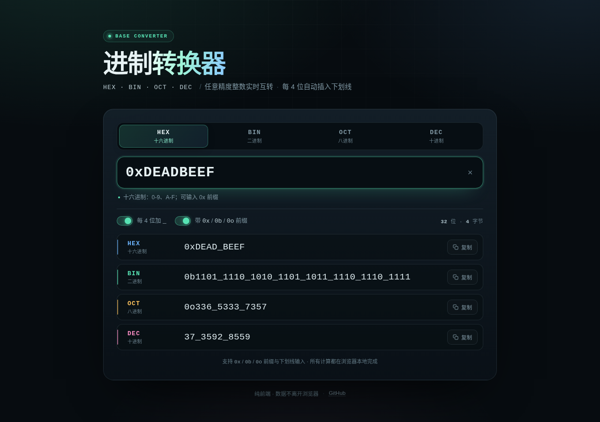

# 进制转换器 · Base Converter

HEX / BIN / OCT / DEC 四种进制实时互转，支持每 4 位自动插入 `_` 分隔。

**在线使用：<https://hana-ame.github.io/base-converter/>**



## 功能

- **四种进制同屏显示**：十六进制（HEX）、二进制（BIN）、八进制（OCT）、十进制（DEC）。
- **4 位分组**：默认每 4 位插入一个下划线，从最低位向左分组：
  - `3735928559` → `37_3592_8559`
  - `0xDEADBEEF` → `0xDEAD_BEEF`
  - `0b11011110101011011011111011101111` → `0b1101_1110_1010_1101_1011_1110_1110_1111`
- **前缀自动识别**：输入 `0xFF`、`0b1010`、`0o777` 会自动切到对应进制。
- **任意精度整数**：基于 `BigInt`，超过 `2^53` 的大整数也能精确转换。
- **负数支持**：`-255` → `-0xFF` / `-0b1111_1111` / `-0o377`。
- **宽松输入**：空格与 `_` 会被忽略，例如 `1111_1111`、`FF FF`。
- **一键复制**：复制当前显示的内容（含前缀与下划线），可分别关闭分组或前缀。
- **位宽信息**：实时显示有效位数与字节数。
- **纯前端、零依赖、无网络请求**：所有计算在浏览器本地完成，偏好保存在 `localStorage`。

## 输入与交互

1. 用上方标签选择当前输入进制（默认 DEC）。
2. 在输入框输入整数；对应进制允许的字符：
   - HEX：`0-9`、`A-F`（不区分大小写）
   - BIN：`0`、`1`
   - OCT：`0-7`
   - DEC：`0-9`
3. 四个结果行会实时更新，点击每行右侧「复制」复制对应表示。
4. 切换进制标签时会**保留数值**，并把输入框改写成新进制的数字。例如输入 `255`（DEC）后点 HEX，输入框变为 `FF`。
5. 快捷操作：`Esc` 清空输入；输入前缀可自动切换进制。

> 仅支持整数，不支持小数与分数。

## 本地运行

直接双击打开 `index.html` 即可（`converter.js` 是本地同目录文件，无需服务器）。也可以：

```bash
python3 -m http.server 8123
# 打开 http://127.0.0.1:8123/
```

## 测试

核心转换逻辑的单元测试（含随机大整数往返、四种进制、分组、前缀、负数、非法输入）：

```bash
node test_converter.js
```

## 文件结构

```
base-converter/
├─ index.html        页面、样式与交互
├─ converter.js      转换核心（浏览器 global / Node module 通用）
├─ test_converter.js Node 单元测试
└─ .nojekyll         关闭 GitHub Pages 的 Jekyll 处理
```

## 部署

GitHub Pages 直接从 `main` 分支根目录发布，无构建步骤；推送后自动更新：

```bash
git push origin main
```

页面地址：<https://hana-ame.github.io/base-converter/>